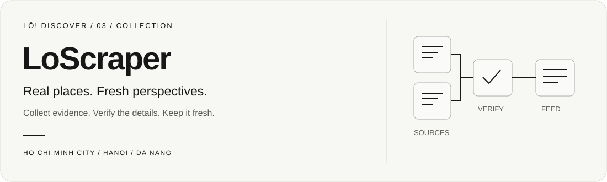

<p align="center">
  
</p>

<p align="center">
  
  
  
</p>

<p align="center">
  <a href="docs/teammate-setup.md">Teammate setup</a> ·
  <a href="docs/tool-status.md">Tool status</a> ·
  <a href="docs/trending.md">Workflow</a> ·
  <a href="https://www.lodiscover.com/">Product</a>
</p>

# Lô! · Scraper

Turn local source pages into places people can actually visit. LoScraper collects and verifies events and recently mentioned destinations for **What’s Trending** in Ho Chi Minh City, Hanoi, and Da Nang.

**[Reliability update and operator health](docs/reliability.md)** — migration order, failure recovery, and fresh validation evidence.

**[Watch the actual 45-second demo](docs/demo.md)** — cities, filters, real API results, and venue navigation.


**[Coverage and imagery follow-up](docs/coverage-followup.md)** — local setup, review dependencies, validation and remaining limits.

## From source to screen

**Collect → normalize → validate → upsert → serve through Encore → render in LoApp.**

Candidates retain their original sources, location evidence, dates, and verification timestamps. Stable IDs preserve valid records across reruns. The feed applies a seven-day window, removes expired evidence, and keeps external popularity separate from Lô ratings.

**Stack:** Python · Requests · Beautiful Soup · Playwright · psycopg/PostgreSQL · GitHub Actions. Pinned dependencies live in [requirements.txt](requirements.txt).

## Try website collection

From this repository, with Python and Chrome installed:

```sh
python3 -m venv .venv
.venv/bin/python -m pip install -r requirements.txt
LO_BROWSER_CHANNEL=chrome .venv/bin/python -m trending \
  --browser --pilot --limit 5
```

This inspects up to five detail pages **per source**. It requires no provider credentials and writes no database records. HTTP-only collection can omit `--browser`; browser-dependent sources will be skipped.

For a focused run:

```sh
LO_BROWSER_CHANNEL=chrome .venv/bin/python -m trending \
  --browser --pilot --city hanoi --sources hanoigrapevine,vnexpress --limit 5
```

Follow the **[teammate guide](docs/teammate-setup.md)** to create an isolated database, import verified records, and open the UI. Import and provider collection require explicit flags; they are not part of this quick check.

## Source coverage

| Source | Focus |
|---|---|
| Vietnam Nightlife | Nightlife venues and recurring schedules. |
| Ticketbox | Ticketed events, workshops, and individual sessions. |
| Hanoi Grapevine | Exhibitions, performances, and cultural experiences. |
| Danang Fantasticity | Official local events and activities. |
| VnExpress | Food destinations with recent dated evidence. |
| TicketGo | Performances and workshops with resolvable schedules. |

Optional supplemental discovery follows links from **Life of Da Nang, Saigoneer, and Visit HCMC**. Image reuse is permission-gated; cards currently use neutral placeholders.

## Current status

| Path | State |
|---|---|
| Six websites → local database → trending UI | Passed bounded end-to-end validation. |
| SerpAPI discovery | Implemented with verified included-usage checks and persistent quotas. |
| Bright Data social collection | Billing access resolved; publication disabled after an unsuccessful quality pilot. |
| Apify | Researched alternative; no Actor integration or automatic fallback. |
| Daily GitHub collection | Workflow implemented; scheduling disabled pending rollout. |

No additional spending is authorized. Optional providers fail closed when free capacity cannot be verified. The planned schedule is **06:00 Vietnam time**, guarded by `TRENDING_SCHEDULE_ENABLED`; leave it unset/false during onboarding. Manual workflow validation requires the new workflow on the default branch.

The **[dated status matrix](docs/tool-status.md)** records live results, failed samples, and remaining blockers. A valid API key alone is not permission to incur usage.

## Validate changes

```sh
.venv/bin/python -m unittest discover -s tests -v
```

Database tests are skipped without an explicitly configured disposable PostgreSQL test database. See the [full test setup](docs/teammate-setup.md#8-run-checks-and-interpret-the-results) for persistence tests, browser suites, and prerequisites. Never run destructive tests against your preview or shared database.

## Documentation

| Start here | Purpose |
|---|---|
| [Teammate setup](docs/teammate-setup.md) | All three repos, dependencies, local database, app startup, and troubleshooting. |
| [Tools and status](docs/tool-status.md) | Implemented capabilities, test evidence, and next steps. |
| [Workflow PowerPoint and PDF](docs/presentations/README.md) | One-slide presentation and matching one-page PDF of the hand-drawn workflow. |
| [Pipeline and workflow diagram](docs/trending.md) | Collection, validation, quotas, refresh, and rollout. |
| [Environment example](.env.example) | Configuration names; real values belong in ignored files or Actions secrets. |

<details>
<summary><strong>Legacy nightlife importer</strong></summary>

`run.sh`, `lo_scrape_club_trending_events.py`, and `.github/workflows/scrape-events.yml` belong to the older external-events pipeline. Its `--write-db` calls `replace_external_events`, replacing prior rows for that source. It does not populate the new discovery feed.

The legacy workflow was last observed as `disabled_inactivity`. Use the isolated teammate guide for the new feed rather than running the replacement importer or a broad shared-database migration.

</details>

## The Lô repositories

| Repository | Responsibility |
|---|---|
| [LoApp](https://github.com/khanh19/LoApp) | Expo discovery UI, search, and venue navigation. |
| [LoAppBackend](https://github.com/khanh19/LoAppBackend) | Encore APIs and PostgreSQL access. |
| **LoScraper** · you are here | Source collection, validation, and ingestion. |
