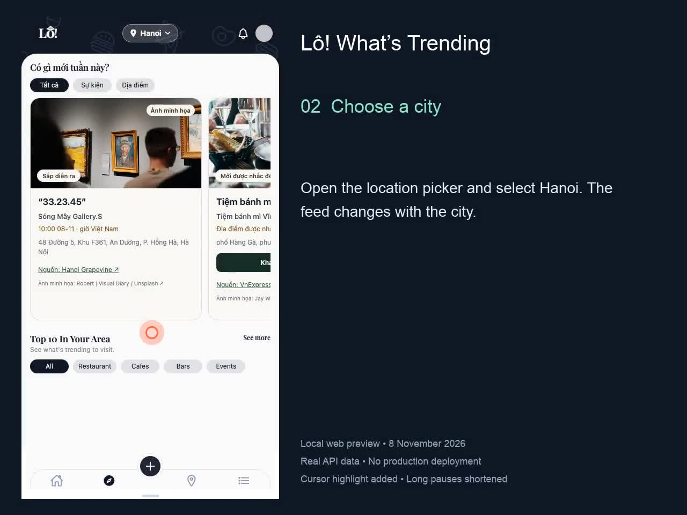
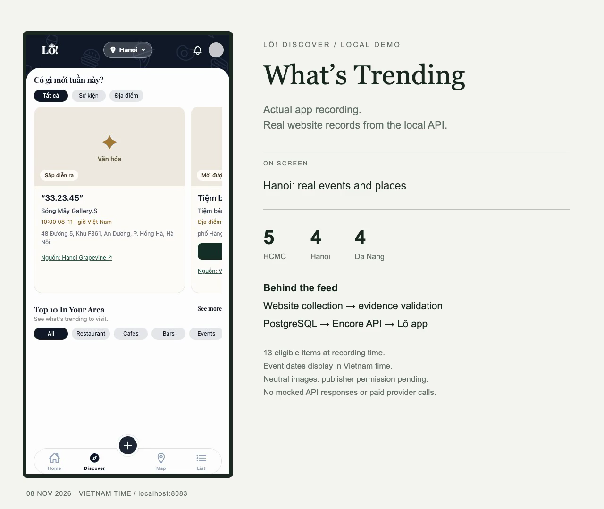

# What’s Trending: user walkthroughs

## Step-by-step walkthrough — 8 November 2026

[Watch/download the MP4](https://raw.githubusercontent.com/khanh19/LoScraper/stephen-trending-coverage/docs/assets/demo/walkthrough-20261108/whats-trending-walkthrough.mp4) · [Video file](assets/demo/walkthrough-20261108/whats-trending-walkthrough.mp4) · [Chapter list](assets/demo/walkthrough-20261108/chapters.json)

A **1-minute-45-second** silent, captioned walkthrough (about 1.7 MB) with **17 numbered steps and visible click
highlights**, recorded from the actual local web app. It demonstrates:

1. Opening Discover and choosing Hanoi.
2. Switching event/place filters and scrolling the carousel to read dates and prices.
3. Clicking the original publisher link and viewing its actual page in a new tab.
4. Opening image credits, then returning to the app.
5. Opening a confidently matched venue and reading its stored address/details.
6. Returning through the Discover tab, changing to HCMC, checking an empty place
   feed, and clicking refresh.
7. Switching to Da Nang and browsing its eligible event cards.

The Unsplash credit URL opened, but the external site denied access in this
recording browser. That result is shown and labelled; the bundled category photo
still works in Lô. No permission bypass or substitute page was used.

The feed contained nine eligible items: Hanoi 3, HCMC 4 and Da Nang 2. No API
responses were mocked. Captions and cursor highlights were added for readability;
long pauses were shortened. This is a local web demonstration, not native iOS or
production. Social publication and live Google requests remain disabled. Venue
Call/Website/Hour/Menu buttons are outside the demonstrated flows and are not
claimed as verified actions.

Playback and seeking were verified in Chrome; all 16 local API responses succeeded
and no page exceptions were recorded. [Verification receipt](assets/demo/walkthrough-20261108/verification.json).

The earlier overview remains below for history; its counts and placeholder imagery
represent the previous build.

---

## Earlier 45-second overview

[Download/watch the 45-second MP4](https://raw.githubusercontent.com/khanh19/LoScraper/stephen-develop/docs/assets/demo/whats-trending-demo.mp4) · [Video file](assets/demo/whats-trending-demo.mp4)

Recorded 7 November 2026 in New York / 8 November in Vietnam. This silent, captioned recording shows the actual Expo app reading the isolated Encore API and previously collected website evidence. No backend responses were mocked.

At capture: **13 eligible items** — HCMC 5, Hanoi 4, Da Nang 4. The recording shows event/place filters, event dates/prices, a matched local venue, city changes, an honest empty state, refresh, and the source action. The return from venue details uses direct navigation to Discover; the original publisher opens in a separate tab, which is not included in the main video.

Recording checks: zero page exceptions; all 20 observed local API responses succeeded; MP4 playback and seeking verified. This is a dated local demonstration, not a production deployment or a new scrape. Publisher images intentionally use placeholders. Social publication and scheduling remain disabled; live Google retrieval is still blocked pending quota verification.

The MP4 is approximately 1.24 MB, H.264, 1280 × 1080, with no audio. Raw recordings, API payloads, and browser logs remain ignored local artifacts.

See [teammate setup](teammate-setup.md), [status and blockers](tool-status.md), and [pipeline details](trending.md).
