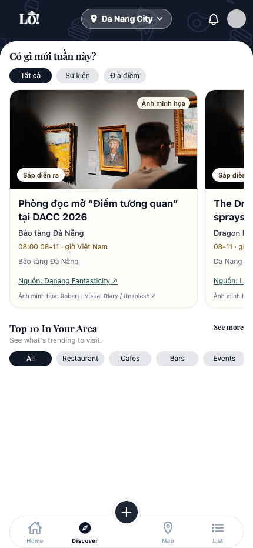
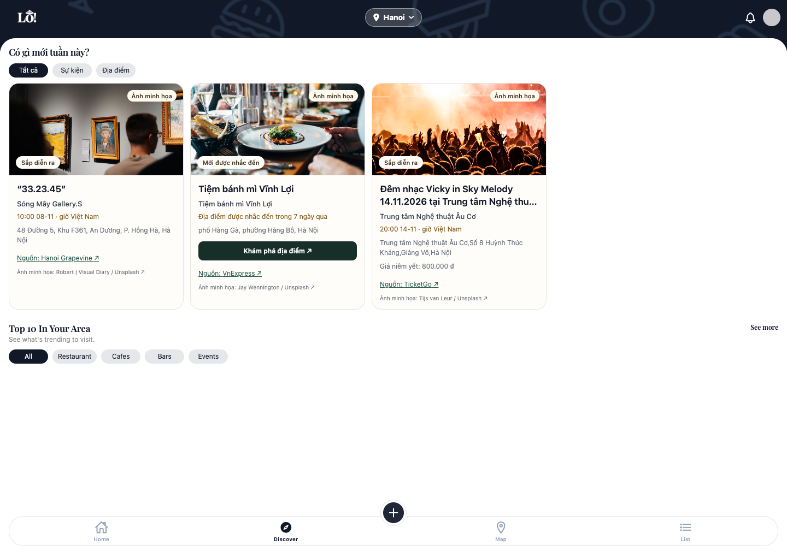
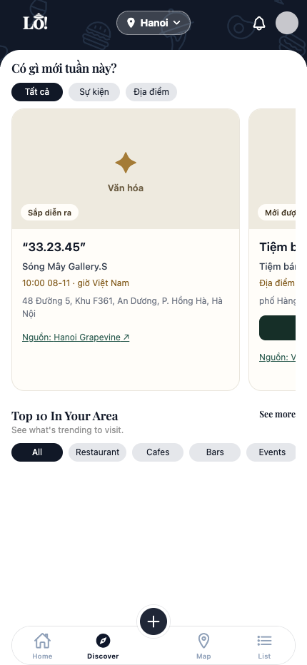

# Local validation evidence — 8 November 2026

`summary.json` contains comparable website counts and the final partial fresh-run
receipt summary. `live-results.json` records actual API/UI checks without replacing
relevant discovery responses. `image-results.json` separates live rendering from
controlled image-network failure. No credentials, raw provider datasets or raw
publisher pages are included.

Photos shown in screenshots are credited category illustrations under the asset
licenses in LoApp's `assets/images/trending/credits.json`; they are not venue photos.
