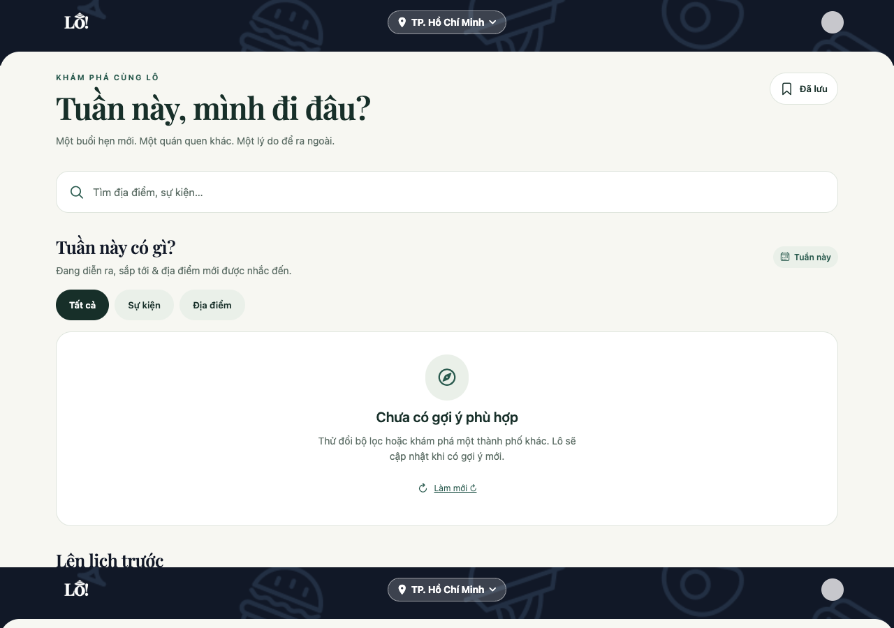

# Multimodal discovery: operator setup and validation

The manual engine finds public leads, retrieves records, extracts cited facts, runs a separate judge, and holds candidates for deterministic eligibility and human review. It does not publish merely because two models agree. Routine social publication and scheduling remain disabled.

## What changed

| Stage | Files | Behavior |
| --- | --- | --- |
| Discovery/configuration | `trending/engine_providers.py`, `engine_store.py`, `__main__.py`, `.env.example` | OpenAI cited web search, YouTube search/video metadata/reviewed uploads, capped Apify TikTok discovery, existing Bright snapshot resumption, durable accounting |
| Evidence extraction | `trending/multimodal.py`, `media.py`, `engine.py`, `duplicates.py` | Structured Vietnamese facts with quotations, original timestamps, bounded images, permission-gated audio/frames, separate judge, optional embedding suggestions |
| Operator review | `trending/publish_reviewed.py`, `health.py` | Explicit per-item human approval, existing shared eligibility checks, optional source-check explanation on eligible details, cost/hold/modality summaries |

Timely discovery prerequisites carried into this branch include the planning API, timing/attention separation, source directory, and query catalogue. Existing reviews on parent branches are preserved.

## 1. Prepare isolated storage

Use the backend sibling checkout containing both additive migrations, in order:

1. All previous discovery migrations, including reliability, roundup, journey, and `20261111060000_discovery_timely.sql`.
2. `20261112060000_discovery_multimodal.sql`.
3. Updated collector; fresh collection; updated API and optional client fields.

Use `docs/setup_local_database.py` against an existing **empty test database** named `lo_setup_check_...`. It applies the full migration sequence and seeds supported cities. Do not apply the bootstrap to an existing preview or the accounting database. PostgreSQL must listen on loopback only.

The validation environment uses PostgreSQL 16 at `127.0.0.1:55443`:

- `lo_setup_check_multimodal`: isolated feed.
- `lo_engine_accounting`: durable new-provider campaign ledger; never truncate or recreate it.
- `lo_trending_test`: disposable scraper integration database.
- `lo_setup_check_journey_tests`: disposable backend integration database.

The cluster is under ignored `.state/multimodal-postgres`. Back it up with `pg_dump` before migrations. Feed databases may be replaced independently; accounting must remain stable across runs and campaigns.

**The old Bright Data/SerpAPI ledger was not recovered.** Installed PostgreSQL 15/16 clusters did not contain the expected `lo_e2e_20261108` database. New Bright jobs stay blocked. This new ledger is not a replacement or reset for historical reservations. Reading the known Instagram snapshot does not launch a new job or establish a fresh source verification time.

## 2. Configure server-side credentials

```sh
cd /Users/macbook/Hack/LoScraper
.venv/bin/pip install -r requirements.txt
export DATABASE_URL=postgresql://macbook@127.0.0.1:55443/lo_setup_check_multimodal
export OPENAI_DATABASE_URL=postgresql://macbook@127.0.0.1:55443/lo_engine_accounting
```

Keep `OPENAI_API_KEY`, `YOUTUBE_API_KEY`, `APIFY_API_KEY`, and existing Bright credentials in an ignored server configuration file. `--env-file` uses a fixed allowlist without evaluating shell expressions. Existing keys can be read from the local LoApp `.env` by the scraper; they must never have `EXPO_PUBLIC_` prefixes. Start the preview frontend with `EXPO_NO_DOTENV=1` to avoid loading that file. Never commit keys or paste them into issues.

YouTube additionally requires `YOUTUBE_QUOTA_VERIFICATION_JSON`, a receipt less than 24 hours old containing `verified_at`, `key_sha256` (the engine's JSON digest of the key), `non_billable: true`, `search_requests_remaining`, and `read_requests_remaining`. Check the key-owning Google Cloud project's Service Usage quotas and Cloud Monitoring daily consumption first. Leave a margin for reporting latency and other clients. The receipt is an operator assertion bound to the key, not permission to guess its allowance.

Apify automatically checks account/limits APIs before new runs: enabled FREE plan, zero monthly base price, hard monthly limit no greater than included credits, active usage cycle, and at least $1 remaining. Each run reserves $1, sets a $0.90 maximum charge plus an ancillary-cost margin, 30 billable items, and a 120-second timeout. Known jobs resume; ambiguous submissions are never resubmitted.

## 3. Run explicitly selected providers

Start without `--live` to inspect planned queries; no provider requests occur:

```sh
.venv/bin/python -m trending.engine --city danang --providers openai
```

A bounded live example:

```sh
.venv/bin/python -m trending.engine \
  --env-file /Users/macbook/Hack/LoApp/.env \
  --providers openai --city danang --category music \
  --live --images --web-evidence --queries-per-city 1 --max-candidates 3 \
  --out pilot-output/engine-danang.json
```

Select `youtube`, `apify`, or `brightdata` explicitly; there is no provider fallback. `--websites` extracts free website social leads. `--snapshots docs/evidence/multimodal-snapshots.json` reads the previously recorded Instagram snapshot only. `--youtube-channels` also reads up to three directory channels per city, but only entries with `channel_id` and ownership evidence; none have been approved yet.

The default source directory covers all three cities. A source's city coverage or a query match is **not** location proof. New accounts need independent ownership evidence and verified venue records before publication. Do not auto-approve discovered profiles.

```sh
.venv/bin/python -m trending.engine --health
.venv/bin/python -m trending.health --env-file .env --json
.venv/bin/python -m trending.duplicates --city hanoi --live
```

The first health command reads the new accounting database; the second reads the feed and existing provider ledger. Neither contacts providers. Duplicate suggestions embed at most 30 already eligible items within a city/category and never merge records.

Exit codes: `0` completed (held candidates are normal), `2` partial/provider blocked, `1` fatal. Save JSON reports locally; routine raw-data artifact uploads are not enabled.

## 4. Evidence and publication gates

- Extraction: `gpt-5.4-mini-2026-03-17`; judge: `gpt-6-astra`; embeddings: `text-embedding-3-small`; permitted audio: `gpt-transcribe`.
- Prompt/schema version `lo-evidence-v2`; request cache includes exact payload/model. Evidence identity includes content, city, and version.
- Six poster/carousel images maximum; up to twelve sampled frames and three minutes of explicitly permitted audio. No YouTube video/caption downloads. YouTube is metadata-only in this implementation.
- Preserve publication, session, fetch, and verification timestamps separately. Cached provider results retain the original verification time. Retention is 29 days for content; accounting remains durable.
- Images analyzed are not automatically licensed for display. Existing permitted imagery and illustrative fallbacks remain in use.
- Untrusted source content cannot execute tools, publish, change budgets, or override instructions. The judge receives original evidence and claims, not extractor confidence or persuasive rationale.
- Missing venues, ambiguous dates, recaps, cancellations, unresolved complete-session conflicts, missing ownership, and expired verification remain held. Search snippets alone cannot become an event.

`python -m trending.publish_reviewed --env-file .env --review path/to/receipt.json` is a manual, isolated-preview import only. The receipt requires a named reviewer, current `reviewed_at`, and per-item `evidence_id`, `approved: true`, and exact `claims_sha256`. Database ownership/location approval and publication gates must also pass. A model must not generate the human approval receipt. Writes are transactional; ambiguous database errors are reported without replay. No routine publication has been enabled.

## 5. Budgets and actual validation

The fixed campaign is `multimodal-v1`. OpenAI reserves a conservative maximum before every request, including images, output/reasoning tokens and search calls. Failed/unknown requests retain reservations. Completed reservations also remain conservative; usage is reconciled separately. Maximum campaign $30 and cumulative Lô $250. Unknown models cannot spend. An over-reservation cost discrepancy blocks subsequent requests.

Other providers remain free-only: Bright maximum150 credits for this campaign plus existing monthly accounting; Apify maximum$3 reserved free credit; YouTube maximum12 searches plus conservative verified remaining allowances. The exhausted six-search Serp pilot was not changed. No subscriptions, recharge, or video downloads.

Validation on 2026-11-08:

| Platform | Discovery | Retrieval | Multimodal/extraction | Validation/publication |
| --- | --- | --- | --- | --- |
| Instagram | Existing automatic lead/snapshot | Passed: one real reel snapshot | Text + one image processed in initial live run | Held: missing independent venue/schedule; snapshot original verification time unknown |
| TikTok | Passed: automatic keyword Actor run | Passed: ten real records | Text processed; thumbnail retrieval failed | Relevant concert leads found, but reviewed samples expired/incomplete; **no eligible live publication** |
| YouTube | Passed: three city searches | Passed: 30 metadata results before deduplication | Metadata extraction/judge passed; no video analysis claimed | Reviewed samples held for recaps/missing local activity facts |
| Facebook | Existing adapter only | Blocked: canonical historical ledger unavailable | No new sample | Blocked |
| Websites/OpenAI search | Four live cited searches; original pages fetched | Passed for selected pages; website source failures also recorded | Structured extraction and judge executed | New shadow samples held; existing website preview has two items |
| Threads | Link discovery capability only | Not independently validated | Not run | Disabled |

**Usage:** OpenAI estimated $0.823225 from returned usage and published rates, with $4.44795 reserved; Apify reported $0.038 from included credit with $1 reserved; YouTube three searches and three video batches; zero new Bright jobs and zero Serp searches. These are not billing invoices. Current health is authoritative after subsequent runs.

**Checks:** 114 scraper tests passed with real PostgreSQL; full Encore package tests passed; dedicated discovery PostgreSQL integration passed, including held/unrelated evidence withholding; frontend TypeScript and lint passed; 12 unmocked browser/API checks across all cities/filters and planning passed, no page errors or failed requests.

[Machine-readable results](evidence/multimodal-20261108/results.json) · [Browser results](evidence/multimodal-20261108/browser-results.json)




## What is still unproven

There is **no human-calibrated judge accuracy, false-acceptance rate, or full paired coverage improvement claim**. Controlled tests use frozen Vietnamese dates, overnight/timezone examples, recaps, conflicting evidence, missing media, injected instructions, budget exhaustion, concurrency and interrupted requests; they are not independent human labels. Website baseline contains Hanoi1/DaNang1/HCMC0, with no recently mentioned places. New social publication is zero. Different source inputs prevent a causal before/after comparison.

Next: recover the canonical Bright ledger; review organizer ownership and locations; assemble independently labelled live examples (up to30/city); resolve TikTok media access; validate permitted audio/frames and reviewed channel uploads; repeat a paired collection evaluation at a common clock. Do not enable routine publication until calibration passes. The existing Da Nang recurring event also warrants precise date-only/session review before rollout.

Preview: `http://localhost:8083/tabs/explore`, API `http://localhost:4101`. Collection remains manual. No deployment, merge, or scheduling occurred.

## References

- [OpenAI web search](https://developers.openai.com/api/docs/guides/tools-web-search) and [evaluation guidance](https://developers.openai.com/api/docs/guides/evaluation-best-practices).
- [YouTube quota costs](https://developers.google.com/youtube/data/determine_quota_cost), [caption permissions](https://developers.google.com/youtube/v3/docs/captions/download), [developer policies](https://developers.google.com/youtube/terms/developer-policies).
- [Apify run limits](https://docs.apify.com/api/v2/actors-runs-post), [account limits](https://docs.apify.com/account/limits), [TikTok Actor](https://apify.com/clockworks/tiktok-scraper).
