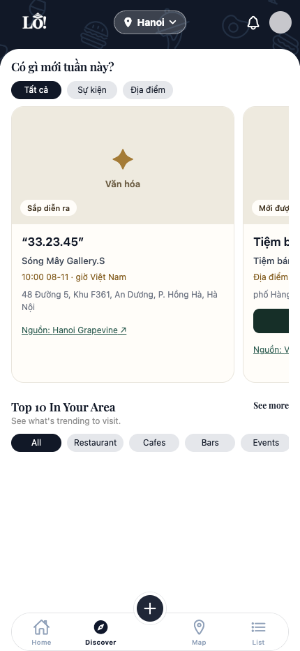
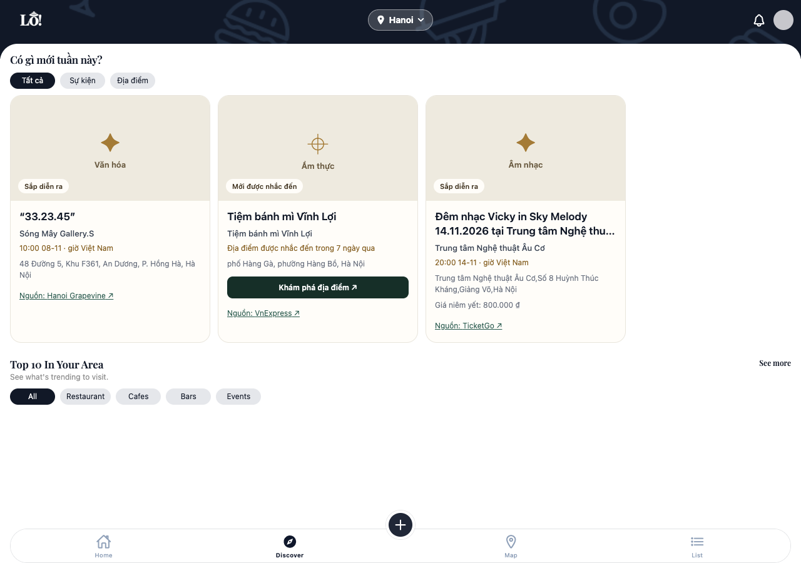

# Trending reliability: setup and validation

Validated **7 November 2026 New York / 8 November Vietnam** on `stephen-develop`.
This batch changes the website pipeline and backend eligibility; it does not enable
social collection, production deployment, merging, or scheduling.

## What changed

- `trending/progress.py`, `__main__.py`, and `adapters.py`: a parent run receipt is
  created before collection in database-write mode, with child receipts before each
  source. Requested cities/sources, counters, reason codes, and page/candidate
  heartbeats survive interruption. Dry runs without `--write-db` remain read-only
  and produce local summaries, not persisted receipts.
- `trending/store.py`: each candidate is transactional. A malformed candidate,
  parser exception, source failure, or candidate write failure does not discard
  earlier imports or stop unrelated work. Source URL reuse cannot change city or
  kind. Identity conflicts are validation rejections.
- One connection recovery is allowed per invocation, including an initial failed
  connection. Failed writes are never replayed automatically: their commit state
  may be ambiguous. If recovery fails, persistence stops and the local summary
  reports failure. An ambiguous initial receipt prevents all imports.
- Observation `facts.version=1` stores title/description/category, original title,
  venue/address, price, and confidently matched place ID together. Social evidence
  cannot replace primary website display facts.
- Backend migration `20261108070000_discovery_reliability.sql` supplies the shared
  `public.discovery_evaluate(now,city)` function. Both the public API and health
  report use it. The freshest complete eligible website observation supplies all
  displayed facts, image attribution, verification time and occurrence; ties use
  source slug then canonical URL. Its source link is first, followed by supporting
  evidence. Stable IDs and the public API response contract are unchanged.
- Every relevant fresh website schedule must cover the other schedules in both
  directions. Exact timed intervals match; date-only intervals must contain the
  entire timed interval. Any unmatched session holds the whole event with reason
  `unresolved_sessions`, not `cancelled`. Expired sessions do not create conflicts.
- Seven days means **168 elapsed hours**, independent of the database connection's
  daylight-saving time zone. Vietnam has no daylight-saving clock change.

## Migration order for teammates

Keep the existing preview database intact. For a new isolated preview, follow
[teammate setup](teammate-setup.md); `docs/setup_local_database.py` already applies
all numbered migrations, including both discovery migrations, in order. The
PostgreSQL integration test bootstrap now does the same for discovery migrations.

For an existing **local** database, apply only the new additive migration once,
using your migration tracking process. Do not rerun the original discovery schema
or the empty-database bootstrap against it. Stage the change in this order:

1. Apply `20261108070000_discovery_reliability.sql` after the original
   `20261108060000_discovery_trending.sql`.
2. Run the updated collector against that same database, with website collection
   only. For example, after configuring `DATABASE_URL` in ignored `.env`:

   ```sh
   LO_BROWSER_CHANNEL=chrome .venv/bin/python -m trending --env-file .env \
     --browser --write-db --limit 12
   ```

   `--pilot --write-db` additionally permits disabled adapters only on loopback
   test databases. Do not add `--providers` for this validation.
3. Inspect receipts and fresh eligible content with the health command below.
4. Start the updated local backend against the same database, with
   `LO_DATABASE_URL` and `LO_DISABLE_GOOGLE_REQUESTS=1`, then point Expo at it.

Historical observations remain stored, but **no display facts are fabricated by
copying old shared item text**. The updated API withholds observations lacking a
complete snapshot until their pages are successfully recollected. This intentional
transition may temporarily shrink the feed. No production migration was run.

## Operator health

```sh
.venv/bin/python -m trending.health --env-file .env
.venv/bin/python -m trending.health --env-file .env --city hanoi --json
```

This command runs a read-only, repeatable-read transaction. It does not scrape,
contact providers, refresh verification timestamps, or change run statuses. It
reports:

- last attempted and completed collection for each source/city;
- parent/source run status, counts and sanitized reason summaries;
- `interrupted` for a still-running receipt whose last heartbeat is over 30 minutes
  old (derived for display, never written back);
- eligible event/place totals, withheld reasons, and items whose last eligible
  evidence expires within 24 hours, including publication-age expiry for places;
- persisted reservations and unresolved provider jobs, explicitly **local
  accounting, not a live provider balance**.

City counters cover candidates whose city could be established. Source-wide page
failures can have unknown location; they are not invented as per-city failures.
Parent totals summarize child work; do not sum parent and child receipts together.
Eligible totals are uncapped; the public feed additionally applies its requested
`limit`. An empty eligible feed is separate from failed collection history.

Collector exit codes: **0 complete**, **2 partial**, **1 failed**. Validation
rejections alone are normal and can finish with 0. A source with failures and no
successful imports is failed; mixed success is partial. The parent is partial
when other source work succeeded, or failed if persistence could not recover or no
source work succeeded. Inspect diagnostics before retrying an ambiguous write.
The existing Actions step treats exit 2 as non-success; this does not undo imports.

## Evidence for this batch

All testing used a new loopback PostgreSQL 16 cluster on port `55442`; the existing
preview databases were preserved. Tests used `lo_trending_guards_test`, live preview
used `lo_setup_check_reliability`, and legacy upgrade used `lo_trending_legacy_upgrade`.

| Path | Result | Evidence |
|---|---|---|
| Scraper unit + PostgreSQL integration | Passed | 55 tests, zero skipped; parser/source isolation, transaction rollback, bounded reconnect, ambiguous receipt, interruption, fact authority, identity, full schedule coverage, expiry, quota guards |
| Legacy migration | Passed | Existing item ID retained; old facts remained absent; withheld until successful refresh; then eligible |
| Full local bootstrap | Passed | All migrations applied; three cities; no demo venues |
| Encore tests | Passed | `encore test -p 1 ./...` |
| Six live website adapters | Passed | 12 detail pages/source; 8 accepted, 64 validation rejections, zero failures; exit 0 |
| Repeat import | Passed | Same eight item IDs, no duplicates; original observation timestamps retained |
| Actual API and health | Passed | All nine city/filter combinations; matching eligibility counts; invalid parameters rejected |
| Unmocked mobile and desktop UI | Passed | Real API responses, city/filter selection, scrolling, empty/refresh states, source action and matched venue navigation |
| Browser errors | Limitation | No page exceptions, failed requests, or API HTTP errors; one existing `/favicon.ico` 404 console error |
| Live providers | Not run | Zero provider jobs/reservations in the isolated DB; no `--providers`, Google outbound calls disabled |
| Native iOS, deployment, default-branch workflows | Not run | Outside this batch; no merge or scheduling changes |

Live snapshot: **HCMC 4 events; Hanoi 2 events + 1 place; Da Nang 1 event**.
These are dated observations, not permanent seed counts. Smaller counts than the
previous preview reflect this bounded run and current eligibility. Ticketbox and
TicketGo dates were checked against publisher event metadata; Da Nang's schedule
was checked against the official event page. Recurring nightlife and exhibition
schedules and the VnExpress publication/location evidence were inspected. All
publisher image permission flags remain false, so neutral placeholders are used.

The venue navigation test copied the existing, source-verified local **Tiệm bánh
mì Vĩnh Lợi** curated record into the new isolated preview, then replayed its fresh
website observation. No Google ID, rating, image, or opening hours were fabricated.
The original preview was only read.





Reproduce the discovery-only browser check with installed Chrome:

```sh
DATABASE_URL="postgresql://$(whoami)@127.0.0.1:55442/lo_setup_check_reliability" \
LO_QA_API_URL=http://localhost:4102 LO_QA_APP_URL=http://localhost:8084 \
LO_QA_OUT=/tmp/lo-reliability-browser \
  .venv/bin/python tests/browser_discovery.py
```

The script never replaces backend responses. A fresh database without a matched
Hanoi place reports venue navigation as blocked rather than manufacturing a match.
Screenshots and sanitized request/check results are written to the local output
directory; raw scrape reports and credentials are not committed.

## Next steps

Review the backend migration and scraper change together; merge/deploy only in a
separately authorized rollout. Confirm fresh coverage after recollection before
switching the API. Social quality pilots, image permissions, fuzzy venue matching,
caching and production rollout remain later work. Live Google capacity and native
QA remain unverified. The favicon is a separate frontend housekeeping item.
