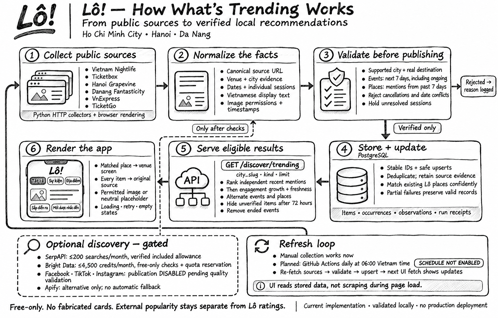

# Verified local discovery

> **Reliability update:** see [migration order, operator health, and current validation](reliability.md). The 55-test / 8-item website snapshot supersedes the earlier test and feed counts below; provider pilot history is unchanged.

Start with the [teammate setup guide](teammate-setup.md) and [tool/status matrix](tool-status.md). This page explains the pipeline and retains the dated end-to-end evidence.



[Download the one-slide PowerPoint](presentations/whats-trending-workflow.pptx) · [View the one-page PDF](presentations/whats-trending-workflow.pdf). The hand-drawn artwork is preserved as one image.

Workflow snapshot: 7 November 2026 in New York / 8 November 2026 in Vietnam. Solid arrows show the main data flow; the dashed branch is optional provider discovery. Social publication and the daily schedule remain disabled.

The `trending` package collects visitable events and places for HCMC, Hanoi and Da Nang. It is separate from the legacy nightlife importer. It never calls `replace_external_events`, deletes another city's feed, translates through a paid service, or downloads videos/posters.

## Run locally

```sh
cd /Users/macbook/Hack/LoScraper
python3 -m venv .venv
.venv/bin/pip install -r requirements.txt
# Reuse Chrome on a Mac; a simulator and Xcode are unnecessary.
LO_BROWSER_CHANNEL=chrome .venv/bin/python -m trending --browser --pilot --limit 20
# A smaller source/city inspection:
LO_BROWSER_CHANNEL=chrome .venv/bin/python -m trending --browser --pilot --city hanoi --sources hanoigrapevine,vnexpress --limit 10
```

On a machine without Chrome, install Chromium with `.venv/bin/python -m playwright install chromium` and leave `LO_BROWSER_CHANNEL` unset. HTTP-only collection is available without `--browser`; Ticketbox and Vietnamese VnExpress will report `browser_disabled` and other sources continue.

The default is a read-only run. For teammate imports, create the fully isolated local database using the setup guide, supply its `DATABASE_URL` through the environment or an explicitly loaded ignored `.env`, and add `--write-db`. The discovery migration alone is insufficient to exercise the other backend services. `--pilot --write-db` is restricted to loopback databases. Failed/invalid candidates do not replace valid observations. Each accepted page has its own transaction.

`--out pilot-output/review.json` writes an optional local audit report. That directory is ignored and GitHub Actions does not upload it. `--env-file` may be repeated and only reads an allowlist of collector configuration. It does not execute shell syntax or print credentials:

```sh
LO_BROWSER_CHANNEL=chrome .venv/bin/python -m trending --browser --pilot \
  --env-file .env
```

An API key alone never enables a provider. Add `--providers` explicitly and provide a persistent quota database. Credentials should ultimately live in the scraper's ignored `.env` or GitHub Actions secrets, never in a mobile bundle. `BRIGHT_DATA_API_KEY` is accepted as a local alias for `BRIGHTDATA_API_KEY`.

## Sources and publication

Six adapters have passed the bounded local pilot and are enabled in `trending/sources.json`. Ticketbox resolves its individual **Lịch diễn** sessions; TicketGo uses structured events. Hanoi Grapevine reads editorial schedule/address blocks and rejects multi-venue roundups. Fantasticity follows official campaign links to individual activities. Nightlife corroborates destinations against its venue pages. VnExpress uses original article publication dates and explicit destination/address evidence in the opening article paragraphs; it does not use sidebar/footer locations.

`--supplemental` discovers primary-source links from Life of Da Nang Weekly, Saigoneer and Visit HCMC. These are not assumed to publish daily. Wikipedia is not ingested. Unknown formats, unsupported cities, missing destinations, cancellations and unresolved schedules are rejected with reason codes. Source failures appear in run receipts. `no_detail_links` flags a likely layout change instead of reporting a silent success.

Every candidate retains canonical source and location-evidence URLs, original text, publication and verification dates, event occurrences, image provenance, and Vietnamese display fields. Structured VND prices are captured when supplied. Official names remain unchanged. Image URLs are collected, but all publishers currently have `image_permission: false`; cards therefore use neutral placeholders. Enable image reuse only after recording the publisher's permission/licence and attribution requirements.

Stable fingerprints use kind, city, normalized venue/address and event title. A known source URL preserves its ID through edits. Exact matching deduplicates supporting sources without combining similarly named branches. Existing Lô places require exact city, name and address agreement. Less certain matches remain source-linked items.

The backend applies a rolling seven-day window in Vietnam time, including ongoing events. Places require a genuinely recent dated mention. Re-scraping an old article does not refresh its publication date. Observations expire after 72 hours without verification; a confirmed cancellation remains effective until that source confirms reinstatement. Fresh contradictory event schedules are held out. Independent owner/content counts come first, then hourly engagement growth normalized within platform/city, then evidence freshness and event start. Events and places alternate; sparse categories are not padded. External evidence is never a Lô rating.

## Provider gates and actual account checks

Updated 2026-11-08 ICT. Read-only account checks were followed by the bounded live pilot described below.

* **SerpAPI:** authenticated, Active free plan, 244 included searches remaining after six pilot searches. Our maximum remains 200/month. Each search checks the account again and reserves a unit in Postgres before requesting results. Paid, unknown or exhausted plans are disabled. In-flight/uncertain reservations stay charged conservatively. [Account API](https://serpapi.com/account-api)
* **Bright Data:** the separate Finance key now passes billing reads (HTTP 200), and both credentials match the inspected account. The original scraping key remains User. Safari inspection verified 5,000 free credits before the pilot, $0 consumed, $7 entirely from $2/$5 promotional bonuses, no deposited funds, and auto-recharge off. General billing alerts are on. Three one-record attempts were reserved: one Facebook record completed; one Facebook and one Instagram trigger returned HTTP 400. No retries or new submissions followed. The returned Facebook post was a broad DACC campaign roundup, not evidence for an individual event, so it was not published. Final monetary reads still show $7 promotional balance and zero credit, prepayment and pending costs. The dashboard could not be reopened after the pilot due to a Safari-control connection failure, so an exact post-pilot free-credit total is not claimed. All three reservations remain counted conservatively. [Balance API](https://docs.brightdata.com/api-reference/account-management-api/Get_total_balance_through_API), [free tier](https://docs.brightdata.com/general/account/billing-and-pricing/free-tier)
* **Apify:** authenticated; account reports plan `FREE` and $5 monthly usage credits. No Actor was run. It remains an alternative for a separately bounded quality pilot, not an automatic fallback. Authentication alone is not a quality benchmark or proof of remaining credit. [Private account API](https://docs.apify.com/api/v2/users-me-get)

Bright Data additionally requires `BRIGHTDATA_FREE_VERIFICATION_JSON`: a control-panel receipt no older than 24 hours, in the current UTC billing month, with `account_id`, `verified_at`, `unfunded: true`, `auto_recharge: false`, and integer `free_credits_remaining`. The account ID must match the credentials' `/status` response. By default all four live monetary fields must explicitly be zero. A positive `balance` is accepted only when it exactly matches a finite, nonnegative `promotional_balance_usd` in the receipt and `deposits_checked: true` confirms the transaction history was inspected. `credit`, `prepayment`, and `pending_costs` must still be zero. Missing/malformed fields, deposits, unexplained balance changes, or pending costs fail closed.

The old `no_payment_method` requirement was overly restrictive: the provider documents that adding a card is verification only, and no deposited funds means a hard stop when free credits run out. Its separate $2/$5 promotional bonuses are not the recurring free-credit pool. The collector does not spend those promotional dollars or treat them as additional scraping allowance. This is a documented safeguard plus inspected account state, not an exhaustion test or a guarantee against later account changes. Re-inspect after any funding, plan, payment or recharge change. A fresh receipt is required daily; do not invent one from a zero balance or refresh its timestamp without inspection.

Reservations are deducted under a Postgres advisory lock from verified remaining credits, including completed requests since inspection and older unresolved requests. The separate 4,500/month cap still applies. Shared credits spent outside this collector cannot be measured live through the balance API: use an account with no deposits and no auto-recharge, avoid other consumers during a bounded pilot, and inspect the dashboard again afterwards. No subscription, deposit, top-up, proxy fallback or account changes are performed by the collector.

### Resolving billing permission and checking without scraping

The preferred setup keeps `BRIGHTDATA_API_KEY` at User permission for scraping and supplies a separate Finance credential as `BRIGHTDATA_BILLING_API_KEY` for billing reads. Both must belong to the same Bright Data account. Finance is billing-only, not a narrowly scoped read-only token; our code only uses it for GET requests. Bright Data documents one key per user, so a second key requires a separate account user. The single-key alternative is Admin, which also grants full account/configuration access. Permission expansion requires explicit confirmation; do not refresh the existing key. [API key permissions](https://docs.brightdata.com/api-reference/authentication)

Store the separate credential in the scraper's ignored `.env` or matching GitHub Actions secret, never in chat or a frontend bundle. If absent, billing checks use the existing scraping token. Neither credential is logged. Run:

```sh
.venv/bin/python -m trending.preflight --env-file .env
```

Omit `--env-file .env` until that file exists. This command only reads account endpoints, never starts a collection, and exits nonzero on a blocked gate. Passing means the account checks passed; a persistent quota reservation and a validated social pilot are still required. A fresh dashboard receipt and the separate Finance key were saved to ignored configuration and matching GitHub Actions secrets. The receipt expires after 24 hours; re-inspection is required before later collection. The workflow accepts the optional billing secret but social publication and scheduled provider collection remain disabled.

Latest full validation: 37 tests passed, including ten real PostgreSQL integration tests in the isolated `lo_trending_guards_test` database. Coverage includes promotional-vs-funded balances, malformed values, stale/month-boundary receipts, account mismatch, billing 403, exhausted allowance, concurrent last-credit reservations, old unresolved jobs, and interrupted polling. The existing local feed database was preserved.

Social collection accepts bounded public Facebook posts/videos, TikTok videos and Instagram posts/reels associated with a named independently located destination. Creator location cannot establish venue location. Only dates, text, source/owner references and engagement metrics are retained. YouTube can surface through direct search but is not a metrics provider. Provider IDs persist across runs; submitted jobs resume polling, while ambiguous submissions are held instead of retried. The billing gate is resolved, but the bounded social pilot did not produce a publishable event-specific sample. Facebook/TikTok/Instagram publication therefore stays disabled in `sources.json` even when provider credentials exist. Review a free-only pilot before enabling each social source. Social posts must explicitly corroborate the same city as the independently located venue.

## Validation and rollout

Use the [teammate setup guide](teammate-setup.md#8-run-checks-and-interpret-the-results) for current test commands, isolated databases, ports 4101/8083, and browser prerequisites. The latest results are in the end-to-end table below; earlier 11-item/28-test/33-test snapshots are superseded. Database integration tests require a dedicated disposable database and the sibling backend repository; they do not run merely because unit tests pass.

Production rollout is separate from teammate onboarding. None of the following deployment/schedule steps has been completed by local validation.

Roll out in this order:

1. Review/merge the three `stephen-develop` branches. App/backend include `origin/develop` through merge commits, preserving branch history.
2. Apply the new migration to the existing database and deploy the backend before the frontend requests its endpoint. No production migration has been applied by this change.
3. Make `.github/workflows/trending.yml` available on the repository's default branch. It uses standard public-repository Ubuntu runners. Leave `TRENDING_SCHEDULE_ENABLED` unset/false.
4. Run **Collect verified local discovery** manually with `pilot=true`, `providers=false`. Review counts, rejected reasons and failures. Then run with `pilot=false` against the migrated database. The `DATABASE_URL` repository secret already exists; confirm it targets the intended database. Local/Encore secrets do not transfer to Actions.
5. After those manual runs pass, set repository variable `TRENDING_SCHEDULE_ENABLED=true` for 23:00 UTC / 06:00 Vietnam daily. Scheduled provider use remains off. Optional manual provider runs require their separate Actions secrets and verified free allowance.

The previous nightlife workflow was observed as `disabled_inactivity` and has not been re-enabled. The new workflow cannot be manually dispatched until it exists on the default branch. No scheduled production collection is active. The bounded live social pilot ran but produced no publishable record; see the evidence below.

Monitor `discovery_ingestion_runs` for per-source/city failures and rejection reasons, observation `verified_at` for freshness, and `discovery_provider_jobs` grouped by provider/billing month for reserved usage. Receipts retain 30 days, completed jobs 90 days, and long-unverified items 90 days. Uncertain provider jobs are retained for manual reconciliation; do not delete their reservations to force retries.

## End-to-end validation — 2026-11-08 ICT

Preview: **http://localhost:8083/tabs/explore**. This uses Encore on port 4101 and
`lo_e2e_20261108` on loopback PostgreSQL port 55439. The original 8082/4100 preview
and its database were preserved. The full shared database override covers venue
resolution, lists, onboarding and discovery. Required local migrations and city/
category/vibe seeds were applied without demo venue seeds. One source-verified
Vĩnh Lợi venue was inserted locally to exercise matching and venue navigation;
no Google ID, rating, coordinates, photos or reviews were invented.

| Path | Result | Evidence / limitation |
|---|---|---|
| Six live website adapters | Passed | 120 bounded page candidates; 15 initially accepted and all 15 reviewed. Two TicketGo seasonal listings were withheld because their individual sessions were unresolved. Corrected TicketGo parser was re-run on all four accepted source URLs. |
| Website → database → trending API | Passed | 13 eligible items: HCMC 5 events; Hanoi 3 events + 1 place; Da Nang 4 events. These are a dated snapshot, not permanent seed content. |
| Replay and partial failure | Passed | Re-import kept stable IDs; a controlled failed-source receipt preserved observations and other cities. Ten isolated PostgreSQL integration tests cover expiry, cancellations, conflicting schedules, deduplication and quota persistence. |
| Three cities × three filters | Passed | Actual city picker, API-to-card text, empty place filters, refresh, carousel scrolling and mobile/desktop layouts. All nine API combinations returned the correct kinds/cities; invalid parameters returned 400. |
| Source and matched-place navigation | Passed | Every card has a source action. Tested action URL against API evidence; opened the real local Vĩnh Lợi record through its matched ID. Missing venue data no longer falls back to fabricated reviews, ratings, hours or images. |
| Unmocked browser pass | Passed | `tests/browser_live.py` replaces no backend responses during its normal pass. No page exceptions or failed requests; the remaining console error is an existing `/favicon.ico` 404. Authenticated bookmark reads are now skipped when no user token exists. |
| Search interactions | Passed, controlled provider responses | Rapid-query race, clear input, three city selections, category filtering, empty results, timeout and resolve-to-local-venue navigation. These checks establish UI behaviour, not live Google quality. |
| Live Google autocomplete/details/photos | Blocked | Owning Cloud project and non-billable capacity remain unknown. `LO_DISABLE_GOOGLE_REQUESTS=1` blocks HTTP in both Places and Lists clients. **Zero Google requests**. |
| SerpAPI discovery | Passed | Six searches total, including social URL discovery; account reports 244 remaining included searches. No more searches were submitted. |
| Bright Data billing/access | Passed | Separate Finance credential, matching identities, fresh dashboard receipt, unfunded/promotional-only state and recharge off verified before submission. |
| Bright Data live quality | Failed pilot | Three reservations, two HTTP 400 triggers, one returned Facebook record. Broad campaign mentions cannot corroborate every event at a named venue. Facebook, Instagram and TikTok publication remain disabled; TikTok had no live sample. |
| Fault injection | Passed | Separate suites cover empty/error/retry/image failure, stale query responses, unavailable providers, exhausted allowance and interrupted-job polling. Loading, trending timeout/retry and venue outage/retry also passed in the separate controlled suite. |
| Build checks | Passed | 37 scraper tests including 10 actual PostgreSQL tests; `encore test -p 1 ./...`; frontend type check; lint with 0 errors and 4 pre-existing warnings. Initial parallel Go build exhausted temporary disk space; sequential rerun passed after automatic build cleanup. |
| GitHub manual workflow | Blocked | The new workflow is not on the default branch. The only listed workflow is the old disabled nightlife job. No default merge, deployment or scheduling was performed. |

Re-run the browser checks with the isolated services already running:

```sh
.venv/bin/python tests/browser_live.py
.venv/bin/python tests/browser_faults.py
LO_QA_API_URL=http://localhost:4101 LO_QA_APP_URL=http://localhost:8083 \
  LO_QA_OUT=/tmp/lo-e2e-20261108/faults .venv/bin/python tests/browser_smoke.py
```

The `browser_live.py` normal pass is unmocked; its later search section explicitly
uses controlled autocomplete/resolve responses. `browser_smoke.py` isolates
unrelated services, while `browser_faults.py` injects timing/network failures.
Do not count either as proof of live provider retrieval. Local screenshots and
JSON summaries are under ignored `pilot-output/e2e-20261108/`; no raw-data artifacts
were uploaded. Venue action-row buttons outside the tested source/navigation
flows remain existing placeholders and were not validated as working actions.

Next: identify the Google Cloud project/quotas without exposing its key; review
and correct the failed social inputs in a separately bounded pilot; enable only
sources with successful, event-specific evidence. Retain the existing free-only
gates and re-inspect the dashboard before refreshing its receipt.
